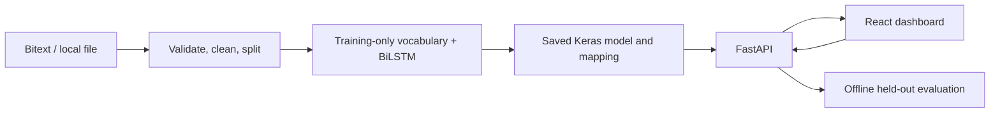
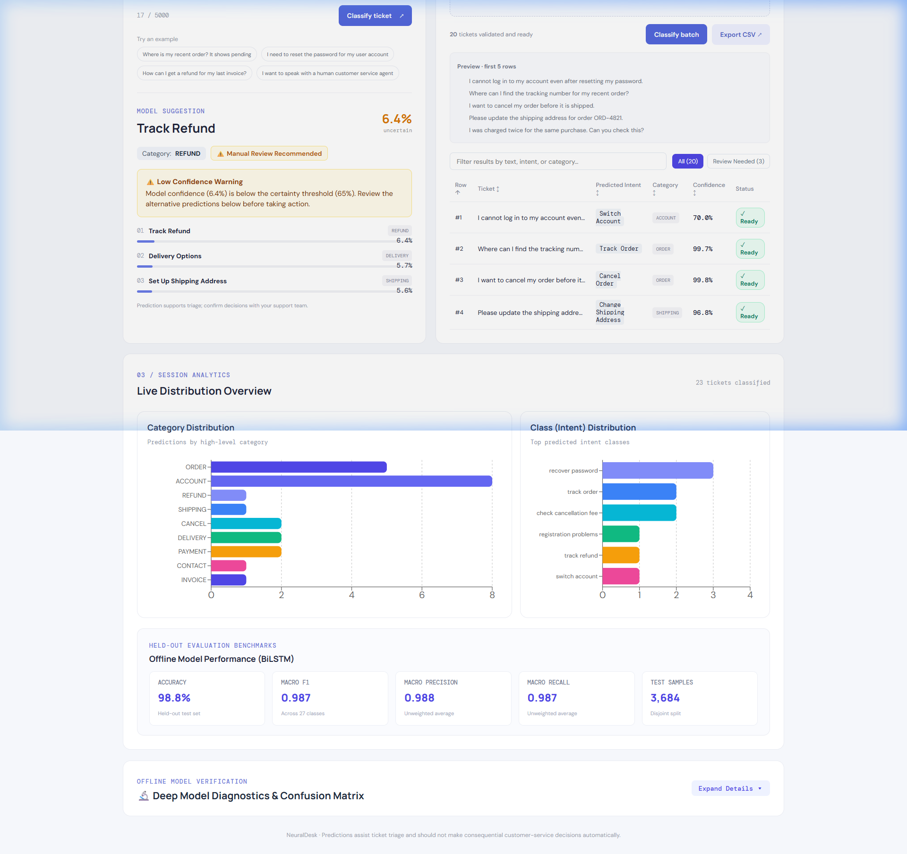
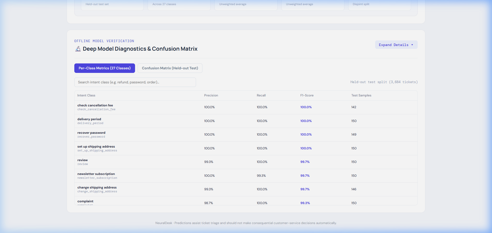

# NeuralDesk

**AI-Powered Support Ticket Intelligence** — a local-first ticket-intent triage demo built with Python, TensorFlow/Keras, FastAPI, React, and Vite.

## What it does

NeuralDesk trains a BiLSTM to predict an intent from a support message and returns its associated category and the model's top three output scores. It supports individual messages and CSV batches, keeps session analytics separate from saved held-out evaluation, and does not use a database or external LLM API.

The intended first step is ticket triage. Predictions are suggestions for a human support team and must not automatically drive consequential customer-service decisions. Scores are model outputs; they have not been calibrated as probabilities.

## Dataset and attribution

The source is [Bitext Customer Support LLM Chatbot Training Dataset](https://huggingface.co/datasets/bitext/Bitext-customer-support-llm-chatbot-training-dataset), maintained by Bitext. The dataset card currently reports 26.9k rows, 27 intents, and 11 category values; the linked GitHub documentation describes 26,872 pairs and 10 categories. The retrieved snapshot contained 26,872 rows; after whitespace normalization and exact-text deduplication, 24,554 remained (27 intents and 11 categories). Fixed-seed splits contain 17,187 training, 3,683 validation, and 3,684 test rows. These counts are recorded in `data/processed/data_quality.json`. The dataset is synthetically expanded customer-support text, not verified real support tickets.

The source dataset declares **CDLA-Sharing-1.0**. Review its [license](https://github.com/bitext/customer-support-llm-chatbot-training-dataset/blob/main/LICENSE.txt) and terms before redistributing source data or derivatives. This repository does not bundle the dataset. See [data/README.md](data/README.md) for caching and local CSV/Parquet fallback details.

The loader uses `instruction` as text, `intent` as target, and keeps `category` for a validated intent mapping. `response` and `flags` are not predictive inputs. It normalizes whitespace, drops empty/missing rows and exact duplicate messages, records decisions, and writes fixed-seed 70/15/15 stratified splits when class counts permit. Splits have no exact duplicate text overlap. Near-duplicate leakage may remain because paraphrase-level deduplication is not performed.

## Architecture



See the [project case study](docs/FINAL_PROJECT_REPORT.md), [architecture overview](docs/architecture.md), and [implementation log](docs/implementation_log.md).

## Stack and model

- Python 3.11, Pandas, NumPy, Hugging Face `datasets`, TensorFlow/Keras, scikit-learn, FastAPI, Pydantic, Uvicorn, pytest, HTTPX.
- React 18, Vite, Recharts, Vitest, React Testing Library.
- TextVectorization → Embedding (64) → Bidirectional LSTM (64 units) → Dropout (0.3) → Dense ReLU (64) → softmax.
- Sparse categorical cross-entropy, Adam, batch 32, up to 5 epochs, early stopping on validation loss. Vocabulary cap 20,000 and sequence length 80. Seed 42.

## Evaluation

The BiLSTM model was trained and evaluated on held-out test data (`reports/metrics.json`):

| Metric | Measured Value | Description |
|---|---|---|
| **Test Accuracy** | **98.78%** | Ratio of correct intent predictions across held-out split |
| **Macro Precision** | **98.77%** | Unweighted average precision across all 27 intent classes |
| **Macro Recall** | **98.71%** | Unweighted average recall across all 27 intent classes |
| **Macro F1-Score** | **98.73%** | Harmonic mean of macro precision and recall |
| **Weighted F1-Score** | **98.78%** | F1-score weighted by support of each intent class |
| **Test Split Size** | **3,684 tickets** | Disjoint held-out split (15% of 24,554 usable rows) |
| **Intent Classes** | **27 intents** | Multiclass targets mapped deterministically to 11 categories |

Generated evaluation artifacts:
- Metrics summary: [`reports/metrics.json`](reports/metrics.json)
- Per-class precision, recall, F1: [`reports/classification_report.json`](reports/classification_report.json)
- Confusion matrix: [`reports/confusion_matrix.png`](reports/confusion_matrix.png) and [`reports/confusion_matrix.csv`](reports/confusion_matrix.csv)
- Training & validation curves: [`reports/training_history.png`](reports/training_history.png)
- Narrative summary: [`reports/evaluation_summary.md`](reports/evaluation_summary.md)

> [!NOTE]
> These measurements describe performance on a held-out split of synthetic Bitext text. Strong performance on synthetic data does not establish equivalent performance on real-world support tickets. Confidence scores are raw model outputs, not calibrated probabilities.

## Application Dashboard & Screenshots


### Batch Classification & Uncertainty Triage



### Deep Model Diagnostics (Per-Class Report & Confusion Matrix)



## Windows 11 setup

Install Python 3.11 (64-bit), Node.js LTS, and Git. From the repository root in PowerShell:

```powershell
py -3.11 -m venv .venv
.\.venv\Scripts\Activate.ps1
python -m pip install --upgrade pip
pip install -r requirements.txt
python -m backend.train_model
uvicorn backend.main:app --reload --host 127.0.0.1 --port 8000
```

Open API docs at <http://127.0.0.1:8000/docs>. In another terminal:

```powershell
cd frontend
npm install
npm run dev
```

Open the Vite URL (normally <http://localhost:5173>). Copy `.env.example` to `frontend/.env.local` to override `VITE_API_BASE_URL`. Hugging Face dataset files are cached under `data/raw/huggingface`; alternatively place a compatible `.csv` or `.parquet` in `data/raw/`.

Run the tests with `python -m pytest` from the root and `npm test` from `frontend/`. Build frontend production assets with `npm run build`.

## REST API

- `GET /health`: server/model status and current process count.
- `POST /predict`: `{"text":"I cannot log in to my account"}`; returns intent, category, model score, and up to three ranked alternatives.
- `POST /predict/batch`: `{"texts":["Where is my order?","Please update my card"]}`; returns an indexed result per row. Maximum 500 rows; each message has a 5,000 character limit.
- `GET /metrics`: saved held-out metrics (if available) and session classification count.

If artifacts are missing, health remains available and prediction endpoints respond 503. Train explicitly with `python -m backend.train_model`; ordinary API requests never train.

## Project layout

See `backend/`, `frontend/`, `data/`, `reports/`, `tests/`, and `docs/`. Raw and processed datasets, environment files, caches, and trained model binaries are excluded from Git. The small evaluation reports and plots above are included and were generated from the held-out test split.

## Known limitations and next steps

- Synthetic data can have repetitive templates and does not represent the diversity or distribution of production support tickets.
- Exact duplicate messages are removed, but the dataset may contain near-duplicate paraphrases across splits.
- One model predicts one intent; no abstention threshold, calibration, multilingual support, online learning, auth, persistence, or human feedback loop is implemented.
- The trained model binary is not included in Git; reproduce it with the documented training command before running predictions from a fresh clone. Add calibration, real-domain evaluation, monitoring, and privacy controls before operational use.

## License

The root [MIT license](LICENSE) covers NeuralDesk code only. The dataset retains its separate CDLA-Sharing-1.0 terms; the project license does not override those terms.
