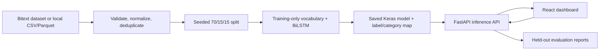
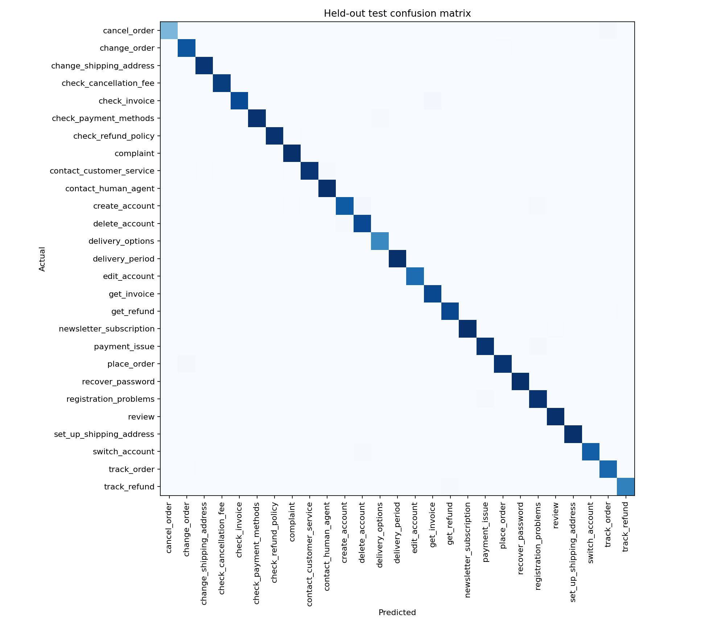
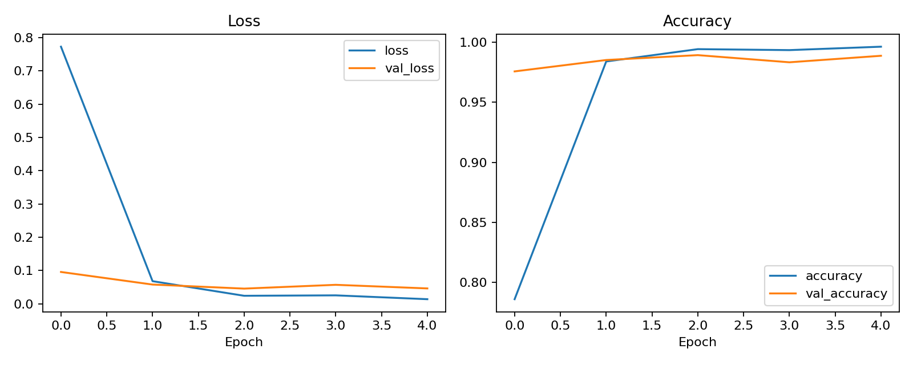
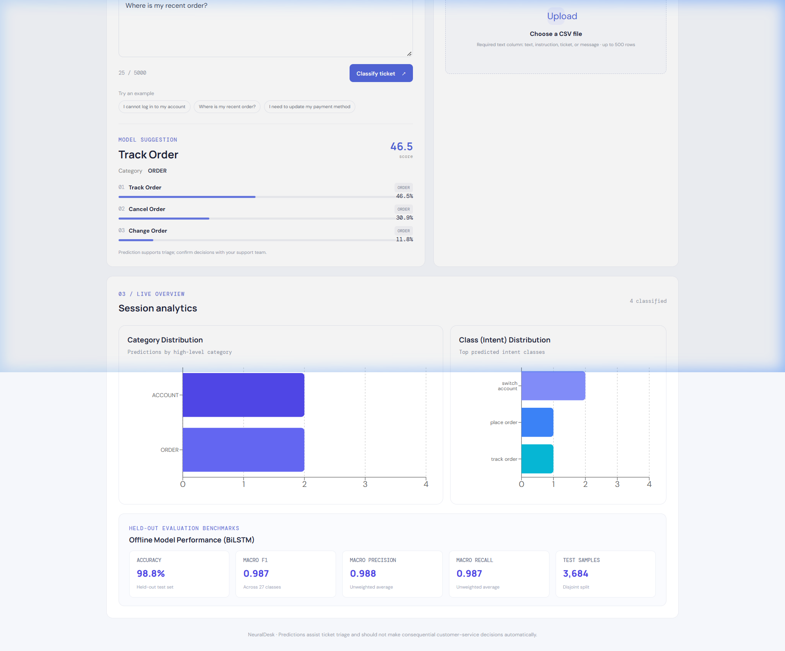

# NeuralDesk: A Case Study in Support Ticket Intent Classification

- **Project:** NeuralDesk — AI-Powered Support Ticket Intelligence
- **Report date:** 27 October 2026
- **Evaluation run:** 26 October 2026
- **Scope:** Local-first prototype using a BiLSTM, FastAPI, and React

## Executive summary

NeuralDesk explores whether a compact recurrent neural network can help support teams sort short customer messages into useful intent queues. The project turns a labeled support-text dataset into a repeatable training pipeline, an HTTP inference service, and a dashboard for single-ticket and CSV batch predictions.

- The run started with **26,872** Bitext records and retained **24,554** unique, usable messages after removing **2,318 exact duplicate texts**. The resulting snapshot contains **27 intents** mapped to **11 categories**.
- A BiLSTM trained for five epochs and was selected using validation loss. On the held-out test split of **3,684 messages**, it achieved **98.78% accuracy** and **98.73% macro F1**.
- The result supports a promising demonstration on this synthetic benchmark. It does **not** establish performance on real support tickets, and the model's output scores are not calibrated probabilities.

## 1. The problem and project objective

Support messages arrive as free text, while a service desk typically needs a structured queue or topic before a person can respond. A classifier could help triage routine messages by suggesting an intent, its broader category, and alternative labels when the wording is ambiguous.

The project objective was to build an end-to-end prototype that can:

1. Train a multiclass intent model from a reproducible dataset pipeline.
2. Serve predictions for one ticket or a bounded CSV batch.
3. Show model suggestions and held-out evaluation measures in a browser dashboard.
4. Keep a human support worker responsible for the final decision.

NeuralDesk is a triage aid, not an automated customer-service decision system.

## 2. Data and preparation

### Source and scope

The training source is Bitext's [Customer Support LLM Chatbot Training Dataset](https://huggingface.co/datasets/bitext/Bitext-customer-support-llm-chatbot-training-dataset). The dataset is synthetically expanded support text; it is not a collection of verified production tickets. The project uses `instruction` as the message, `intent` as the prediction target, and `category` as the validated higher-level mapping for each intent. The `response` and `flags` fields are excluded from model input.

The source dataset declares the separate **CDLA-Sharing-1.0** license. The repository attributes Bitext and does not bundle the raw data. See the [dataset card](https://huggingface.co/datasets/bitext/Bitext-customer-support-llm-chatbot-training-dataset), [license](https://github.com/bitext/customer-support-llm-chatbot-training-dataset/blob/main/LICENSE.txt), and project [data notes](../data/README.md) before redistributing dataset material.

### Cleaning and split strategy

The loader inspects the source schema, normalizes whitespace, removes rows with empty text or missing labels, and removes exact duplicate messages before splitting. In the recorded snapshot, no rows were removed for empty text or missing labels; exact-text deduplication removed 2,318 rows. The cleaned dataset contains 24,554 examples.

The split is fixed-seed (42), stratified where class counts permit, and divided into:

| Split | Messages | Share |
|---|---:|---:|
| Training | 17,187 | 70% |
| Validation | 3,683 | 15% |
| Test | 3,684 | 15% |

Exact duplicates are removed before the split, so identical input strings do not cross split boundaries. The pipeline does not perform semantic or near-duplicate detection; similar paraphrases may remain across splits. The validation set guides model selection, while the test set is held for final evaluation. Text vocabulary adaptation occurs on training text only.

## 3. Model and application design

The model accepts raw text and includes its `TextVectorization` layer, keeping preprocessing consistent between training and inference.



### Architecture and training

| Component | Configuration |
|---|---|
| Text preprocessing | Keras `TextVectorization`, vocabulary cap 20,000, sequence length 80 |
| Embedding | 64 dimensions, padding mask enabled |
| Recurrent layer | Bidirectional LSTM, 64 units in each direction |
| Regularization and classifier | Dropout 0.30; Dense 64 ReLU; 27-unit softmax output |
| Objective and optimizer | Sparse categorical cross-entropy; Adam |
| Training | Seed 42; batch size 32; up to 5 epochs |
| Model selection | Early stopping on validation loss, patience 2, restoring best weights |

The recorded run used TensorFlow 2.16.1 and completed five epochs. The lowest validation loss was **0.0457**; the highest validation accuracy was **98.94%**. These are validation results used during training, not the final test-set score.

### Application workflow

FastAPI loads model artifacts at startup and provides health, single prediction, batch prediction, saved metrics, and confusion-matrix endpoints. Batch requests support up to 500 messages; each message is limited to 5,000 characters. If model artifacts are unavailable, health remains available and prediction requests return HTTP 503 rather than fabricated results.

The React dashboard provides single-ticket input, CSV upload and results export, session-level prediction analytics, and offline test metrics. Session counts describe requests made in the current process; they are separate from the saved held-out evaluation results. The interface labels outputs as model suggestions and reminds operators to confirm decisions with the support team.

## 4. Held-out evaluation

The following metrics are read from the saved evaluation output for the 3,684-message test split. Precision, recall, and F1 are reported as macro averages except weighted F1, which weights classes by support.

| Metric | Held-out result |
|---|---:|
| Accuracy | **98.78%** |
| Macro precision | **98.77%** |
| Macro recall | **98.71%** |
| Macro F1 | **98.73%** |
| Weighted F1 | **98.78%** |
| Correct predictions | **3,639 of 3,684** |

The confusion matrix has 3,639 predictions on its diagonal and 45 off-diagonal errors. Across the 27 per-intent rows in the classification report, `create_account` has the lowest F1 at **96.15%** (precision 98.43%, recall 93.98%, support 133). The aggregate scores therefore do not mean every class performs identically.



The training curves show rapid improvement during the first two epochs, followed by smaller changes. Validation loss is lowest at epoch three and is slightly higher at epoch five, which is consistent with selecting the best validation-loss weights rather than assuming that the final epoch is best.



These measurements describe separation among labels in the held-out synthetic dataset. Repeated templates or a narrow benchmark distribution may make this task easier than classifying messages from a live service desk. No real-ticket test set, calibration study, cross-domain test, or operational impact study is included. The scores must not be presented as evidence of equivalent real-world accuracy.

## 5. Dashboard experience

The dashboard combines the live classification workflow with a separate offline evaluation panel. The screenshot below illustrates the interface, including the model suggestion, top-three scores, category, batch-upload area, and evaluation cards. Its session charts are a small demonstration session; they are not counts from the held-out test set.



The prediction engine also marks outputs as uncertain when the top score is below 0.65 or the gap between the top two scores is below 0.15. These thresholds are operational review flags, not statistically calibrated confidence thresholds.

## 6. What the case study shows

### A training pipeline can be useful without distributing data or model binaries

Dataset acquisition, cleaning, split creation, training, evaluation, and serving are separate modules. The dataset is cached locally, while generated raw/processed data and model binaries are excluded from Git. A new user can reproduce the workflow using the documented commands and license-aware dataset source.

### One-to-one label mapping keeps categories consistent

The classifier predicts one of 27 intents. The API derives the category from the dataset's validated intent-to-category mapping rather than learning or inventing a second relationship. This makes the response easier to inspect and prevents conflicting intent/category outputs.

### High benchmark scores are a starting point, not a deployment decision

The measured results are strong on this held-out synthetic split, with 45 errors among 3,684 examples. They justify further evaluation, not unattended automation. A deployment decision would need representative, permissioned real-ticket data; privacy review; class-specific error analysis; threshold and calibration evaluation; and a process for human correction and monitoring.

## 7. Limitations and responsible use

- **Synthetic source:** The data does not measure the language, class mix, spelling, context, or ambiguity of a specific support organization.
- **Possible near-duplicate leakage:** Exact duplicates are removed, but paraphrases are not clustered or separated by template/source.
- **Single-label output:** The model returns one intent even when a message expresses multiple needs or does not fit any training label.
- **Uncalibrated scores:** Softmax outputs are model scores, not calibrated probabilities. The review thresholds have not been tuned against support-team error costs.
- **No operational evaluation:** The project has no production workload, human-review study, latency/throughput benchmark, or measured improvement in handling time.
- **Artifact reproduction:** Trained model binaries and dataset files are intentionally not committed. A fresh checkout must acquire data and train the model before prediction endpoints can serve results.

Predictions should assist ticket triage only. A qualified support worker must make decisions that affect customer accounts, payments, refunds, access, or service eligibility.

## 8. Reproducing the project on Windows 11

From the repository root in PowerShell:

```powershell
py -3.11 -m venv .venv
.\.venv\Scripts\Activate.ps1
python -m pip install --upgrade pip
pip install -r requirements.txt
python -m backend.train_model
```

Start the API in one terminal:

```powershell
uvicorn backend.main:app --reload --host 127.0.0.1 --port 8000
```

Start the dashboard in a second terminal:

```powershell
cd frontend
npm install
npm run dev
```

The API documentation is available at <http://127.0.0.1:8000/docs>; Vite prints the dashboard URL when it starts. The project includes backend pytest tests and frontend Vitest tests. See the [implementation log](implementation_log.md) for the recorded development and verification history.

## 9. Evidence and project files

- [Measured test metrics](../reports/metrics.json)
- [Per-class classification report](../reports/classification_report.json)
- [Confusion matrix image](../reports/confusion_matrix.png) and [matrix values](../reports/confusion_matrix.csv)
- [Training history plot](../reports/training_history.png)
- [Training pipeline](../backend/train_model.py), [dataset loader](../backend/data_loader.py), and [evaluation code](../backend/evaluate_model.py)
- [Architecture overview](architecture.md) and [dataset notes](../data/README.md)

---

**Conclusion:** NeuralDesk demonstrates a complete path from labeled text to a human-reviewed ticket-intent suggestion. Its held-out results are promising for the Bitext benchmark, while the synthetic data and lack of real-service evaluation limit what can be concluded about production performance.
