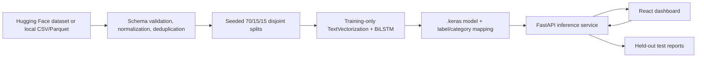

# Architecture

Training and API inference are separate. The input feature is `instruction`; intent is the label and category is derived from a validated one-to-one mapping. The model owns its TextVectorization layer. API startup reports a missing or unloadable model and returns HTTP 503 on prediction requests.
